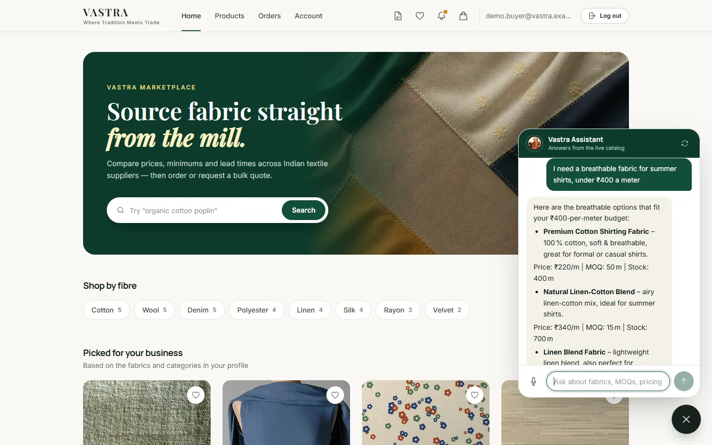
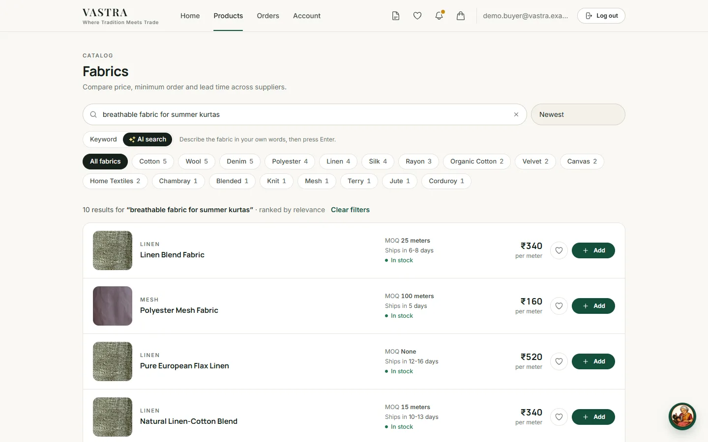
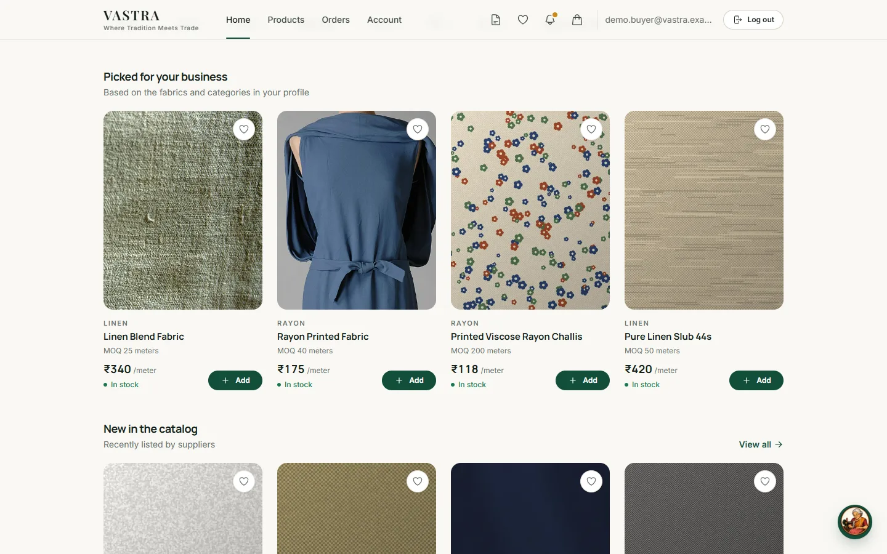
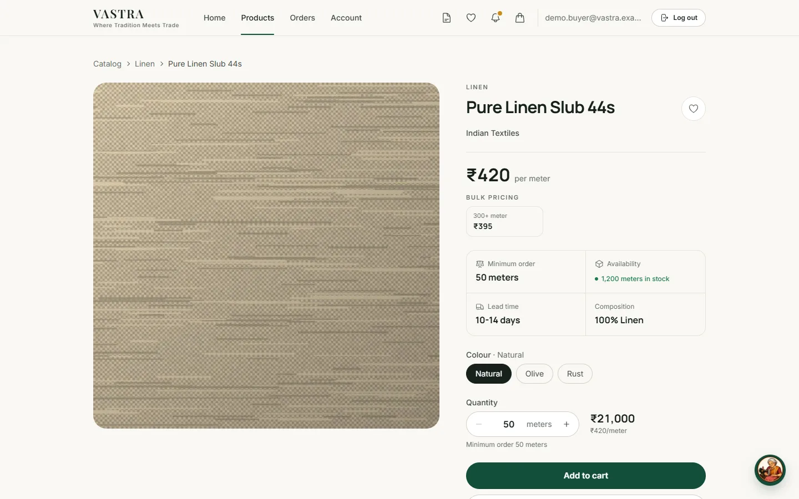
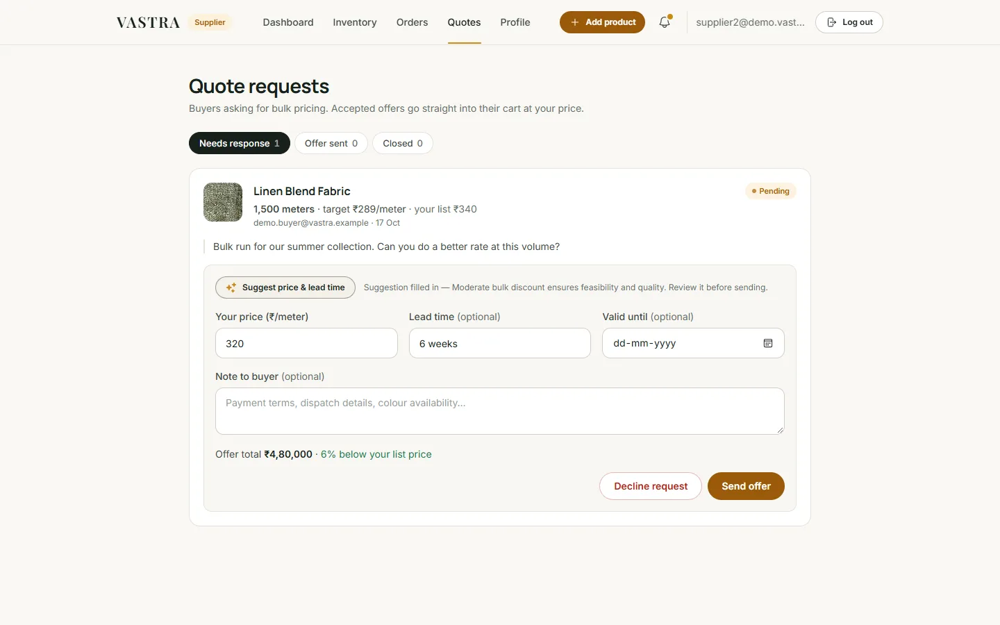
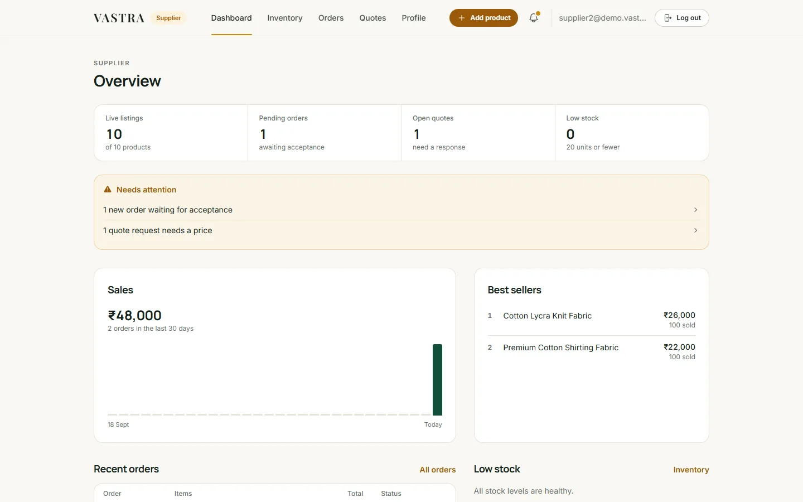
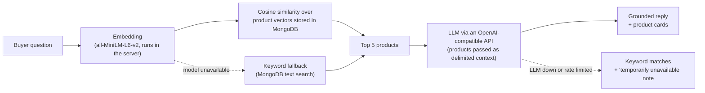

# Vastra

[](https://github.com/manideep311/Vastra/actions/workflows/ci.yml)

Vastra is a B2B textile marketplace. Buyers (boutiques, garment makers, retailers) can source fabric straight from Indian mills and wholesalers. A retrieval-grounded AI assistant answers questions using the live product catalog. Built with React, Express and MongoDB. Embeddings come from a sentence-transformer model that runs inside the server, and replies from an LLM behind any OpenAI-compatible API, such as Groq's free tier. Both are free to run.

**Live demo:** https://vastra-311.vercel.app

The API runs on Render's free tier, so the first request after a quiet period can take a while as the server wakes up.

## Screenshots

| Vastra Assistant | AI search |
| --- | --- |
|  |  |

| Recommendations | Product page |
| --- | --- |
|  |  |

| Supplier quote suggestion | Supplier dashboard |
| --- | --- |
|  |  |

The orders and quote shown were placed by the demo buyer. The assistant's reply and the price suggestion are real responses from the configured LLM.

## Features

### For buyers

- **Browse without an account.** The catalog offers keyword search, category filters and sorting, plus an **AI search** mode that ranks fabrics by meaning (for example, "breathable fabric for summer kurtas").
- **Product pages** show specs, minimum order quantity, bulk price tiers, stock, buyer reviews, similar fabrics found through embeddings, and a link to the supplier's storefront.
- **The cart** enforces each product's minimum order and available stock. A guest cart is merged into the account cart when the buyer signs in.
- **Checkout** reprices everything on the server, reserves stock atomically and creates one order per supplier. No payment is taken in the app; suppliers arrange invoicing directly.
- **Bulk quote requests:** ask a supplier for a price on a large quantity. Accepting the offer puts it in the cart at the negotiated price.
- **Account pages:** order tracking, wishlist, notifications, and reviews (open once an order is completed).
- **Personalised recommendations:** after a short onboarding questionnaire, the home page shows fabrics matched to the buyer's business.
- **Vastra Assistant:** a chat widget that answers questions about the catalog, grounded in real product data.

### For suppliers

- A dashboard with orders, revenue and stock alerts.
- **Inventory:** create and edit listings, upload images (stored as resized WebP variants), and set bulk price tiers. An AI helper suggests a category and tags.
- **Orders:** move each order through `pending → accepted → preparing → ready_for_dispatch → completed`.
- **Quotes:** answer bulk requests. **Suggest price & lead time** fills in an AI suggestion that the supplier reviews before sending.
- A business profile that also powers a public storefront page at `/suppliers/:id`.

## How the assistant works



1. The buyer's latest message is turned into a 384-number vector by `all-MiniLM-L6-v2`. The model runs inside the API process with Transformers.js, so there's no API key and no usage limit.
2. That vector is compared against every product's stored vector with cosine similarity, and the 5 closest products are kept. If the model can't run, MongoDB text search supplies the products instead. When the chat is opened from a product page, that product is the context.
3. The products are sent to the chat model inside a `<catalog>` block in the user turn. The system prompt never changes, and it tells the model to answer only from that catalog and to treat it as data, not instructions.
4. The reply comes back with the referenced products, which the widget shows as cards. If the chat model is down or rate limited, the buyer still gets keyword matches with a short "temporarily unavailable" note instead of an error.

The same vectors power AI search, similar products and recommendations. More detail is in [docs/architecture.md](docs/architecture.md).

## Tech stack

| Layer | Tools |
| --- | --- |
| Client | React 19, Vite 8, React Router 7, Tailwind CSS 4, Axios |
| Server | Node.js 22, Express 5, Mongoose 9, JWT (jsonwebtoken + bcryptjs), helmet, express-rate-limit, multer, sharp |
| Data | MongoDB Atlas (documents, product vectors, GridFS images) |
| AI | `all-MiniLM-L6-v2` embeddings run locally with Transformers.js (ONNX Runtime, 8-bit quantized); chat through any OpenAI-compatible API (Groq, Hugging Face router, Gemini) |
| Testing and CI | Jest, Supertest, mongodb-memory-server, oxlint, GitHub Actions |
| Hosting | Vercel (client), Render (API) |

## Running locally

You need Node.js 22+ and a MongoDB connection string (Atlas or local). For the assistant's replies you also need a free API key from an OpenAI-compatible provider, such as [Groq](https://console.groq.com).

```bash
git clone https://github.com/manideep311/Vastra.git
cd Vastra

# API
cd server
cp .env.example .env        # then fill in the values (see below)
npm install
npm run model:download      # one-time: fetches the 23 MB embedding model into server/.models
npm run dev                 # http://localhost:5000

# Client (in a second terminal)
cd client
cp .env.example .env.local  # optional: only needed if the API isn't on localhost:5000
npm install
npm run dev                 # http://localhost:5173
```

Without an LLM key everything else still works. AI search, similar products and recommendations use the local model, and the assistant answers with keyword matches.

If products in your database were embedded with a different model, re-embed them once with `npm run backfill:embeddings -- --all`.

## Environment variables

### Server (`server/.env`)

| Variable | Required | Purpose |
| --- | --- | --- |
| `MONGO_URI` | yes | MongoDB connection string |
| `JWT_SECRET` | yes | Secret for signing session tokens. The server refuses to start without it. |
| `JWT_EXPIRES_IN` | no | Token lifetime, default `7d` |
| `PORT` | no | API port, default `5000` |
| `NODE_ENV` | no | Set to `production` when deployed |
| `CLIENT_ORIGIN` | in production | Comma-separated CORS allow-list, e.g. `https://vastra-311.vercel.app`. Production refuses to start without it. |
| `TRUST_PROXY` | behind a proxy | Set to `1` on Render or behind one reverse proxy, so rate limits see the real client IP |
| `LLM_BASE_URL` | for chat | OpenAI-compatible endpoint, e.g. `https://api.groq.com/openai/v1` |
| `LLM_API_KEY` | for chat | API key for that provider |
| `LLM_MODEL` | for chat | Model name the provider currently serves. Check the provider's model list, because models get renamed and retired. |
| `EMBEDDING_PROVIDER` | no | `local` (default, free) or `huggingface` (hosted API; needs `HF_TOKEN` and `HF_EMBEDDING_MODEL`) |
| `EMBEDDING_DIM` | no | Expected vector length (384 for all-MiniLM-L6-v2). If unset, it's learned from the first vector. |
| `HF_TOKEN`, `HF_CHAT_MODEL`, `HF_EMBEDDING_MODEL` | no | Only for the Hugging Face providers. They also act as fallbacks when `LLM_API_KEY` and `LLM_MODEL` are empty. |
| `SEED_DEMO_PASSWORD` | for seeding | Password for the demo supplier accounts created by the seed scripts. At least 8 characters. |

### Client (`client/.env.local`)

| Variable | Purpose |
| --- | --- |
| `VITE_API_URL` | API base URL, default `http://localhost:5000` |

## Deploying the API

On Render (or any Node host), use these settings:

- **Build command:** `npm ci && npm run model:download`. The model then ships with the build instead of downloading when a sleeping server wakes up.
- **Start command:** `npm start`
- **Environment:** set `NODE_ENV=production`, `CLIENT_ORIGIN`, `TRUST_PROXY=1` and the `LLM_*` variables, plus the database and JWT settings.

## Seed and maintenance scripts

Run these from `server/`:

| Command | What it does |
| --- | --- |
| `npm run seed:demo` | **Wipes** products, supplier accounts, carts, orders, quotes, reviews, wishlists and notifications, then seeds demo suppliers and products. Buyer accounts are kept. |
| `npm run seed:supplier` | Adds a fixed set of products to one supplier account without deleting anything. |
| `npm run model:download` | Downloads the local embedding model into `server/.models`. Run it once locally and in the deploy build step. |
| `npm run backfill:embeddings` | Creates vectors for products that have none. Add `-- --all` to re-embed every product after changing the model, or `-- --dry-run` to preview. |
| `npm run migrate:images` | Moves legacy disk uploads into MongoDB GridFS. |
| `npm run eval:assistant` | Measures retrieval quality (see below). |

## Tests

```bash
cd server && npm test
```

The API tests use Jest and Supertest against an in-memory MongoDB, with the model providers mocked. They cover:

- role isolation between buyer and supplier tokens;
- ownership checks on products and orders;
- cart MOQ and stock rules;
- server-side checkout pricing, including the concurrent-checkout race;
- AI fallbacks: keyword context when embeddings fail, keyword matches when the chat model is down or rate limited, and products still saving without vectors;
- the local embedding provider (pooling, normalisation, retry after a failed load).

GitHub Actions runs these tests, plus client lint and build, on every push and pull request.

### Assistant retrieval evaluation

`npm run eval:assistant` runs the questions in [`server/eval/questions.json`](server/eval/questions.json) through the same retrieval step the assistant uses. It reports:

- how many products have embeddings;
- average and p95 retrieval latency;
- hit@5: how often an expected product appears in the top 5.

Results from 17 October 2026, measured with the local model against the live catalog (40 questions in [`server/eval/questions.json`](server/eval/questions.json)):

| Metric | Result |
| --- | --- |
| Products with embeddings | 47 / 47 |
| hit@1 (right product ranked first) | 73% (29 / 40) |
| hit@5 (right product in the top 5) | 95% (38 / 40) |
| MRR@5 | 0.825 |
| Retrieval latency | 35 ms median, 61 ms average, 75 ms p95 (n=40) |
| Process memory | 197 MB |

How to read these:
- **Small catalog.** With 47 products, a top-5 list covers about a tenth of the catalog, so hit@5 is the easier metric. hit@1 and MRR say more about ranking quality.
- **Hand-written labels.** The questions and expected answers were written by hand from the catalog, so the scores reflect that judgement. Questions avoid copying product names to keep the test honest.
- **Latency.** The average includes the first question, which also loads the model and builds the vector index.

## Known limitations

- **Linear-scan retrieval.** Every product vector is held in memory and compared on each query. That is fine for a catalog of this size, but a larger catalog would need a vector index (for example, MongoDB Atlas Vector Search).
- **No similarity threshold.** Retrieval always returns the top 5, even when they're only loosely related. The prompt asks the model to say when nothing fits, but nothing filters weak matches beforehand.
- **Only the latest message drives retrieval.** Earlier turns are sent to the chat model (up to 10), but they don't influence which products are retrieved, so follow-ups like "a cheaper one" can pull in unrelated products.
- **Free-tier chat limits.** The chat model runs on a provider's free tier, so heavy use can hit its rate limits. When that happens the assistant falls back to keyword matches until the limit resets.
- **Model in server memory.** The embedding model adds roughly 60 MB to the API process. In local measurements the server peaked around 210 MB while serving AI searches, within Render's 512 MB free tier but not negligible.
- **Single-instance design.** The vector index, embedding cache and rate-limit counters live in process memory.
- **Silent guest-cart merge.** Guest-cart items that fail a stock or MOQ check at sign-in are skipped without a message.
- **No payments.** Orders are placed without payment; suppliers handle invoicing outside the app.

## Project structure

```
client/   React SPA (see client/README.md)
server/   Express API, tests, evaluation set and scripts
docs/     architecture notes
```

## License

[MIT](LICENSE) © 2026 Manideep Chittimodu
